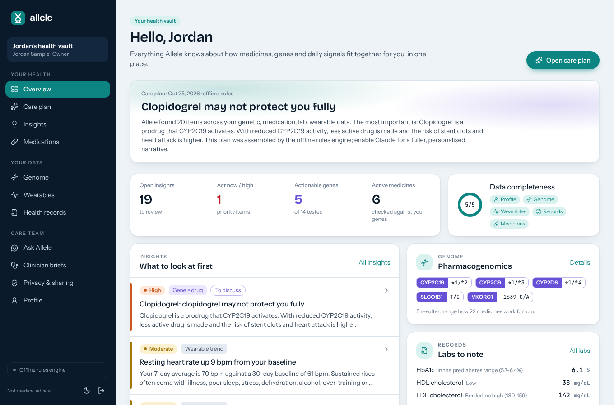
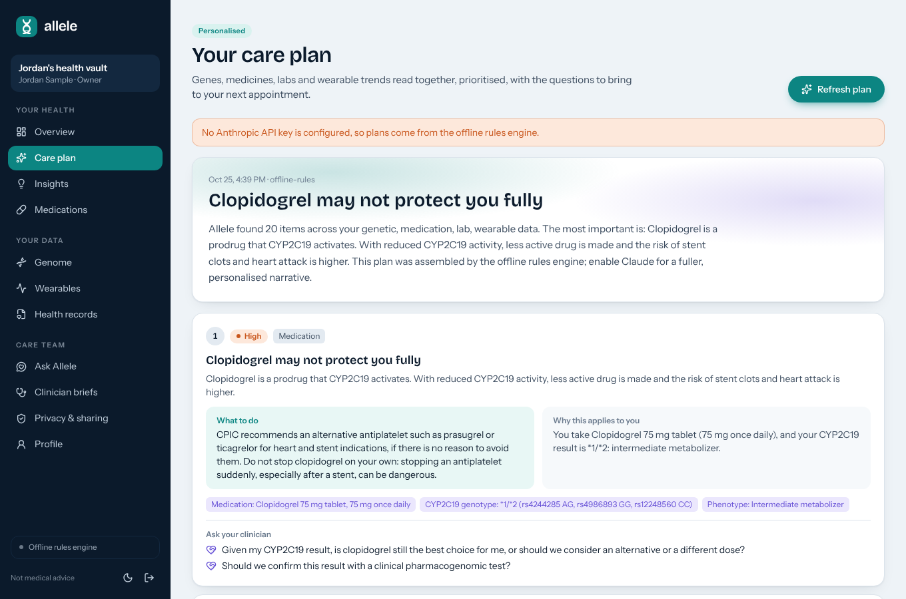
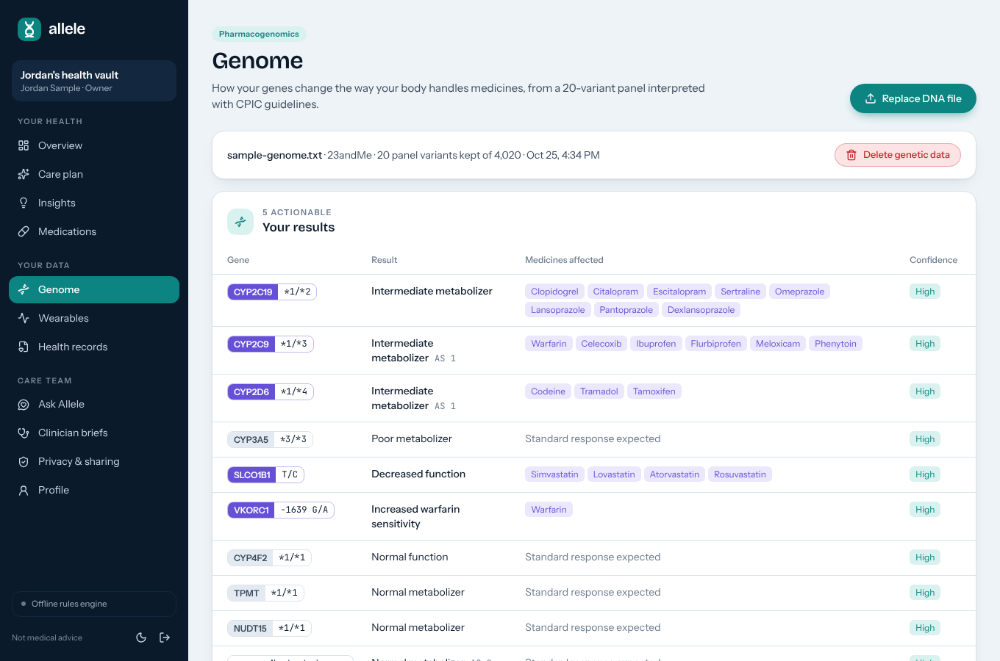
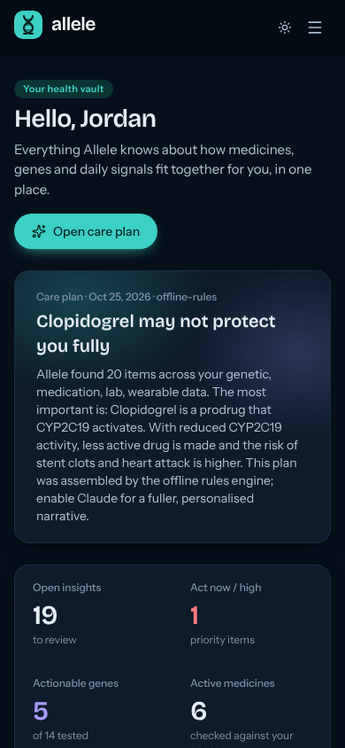

# Allele

**AI personalised medicine.** Allele brings together your DNA, your wearable data and your health records, checks every medicine against clinical guidelines, and turns it all into a care plan you can take to your doctor.

> Medicine that fits your genes, body and history.



---

## Why this exists

Medicine is still prescribed for the average patient. About 9 in 10 people carry at least one gene variant that changes how they respond to a common drug, yet that information sits unused in a 23andMe or AncestryDNA file. Their smartwatch shows that their resting heart rate went up. Their record shows that their LDL is above target. Nobody joins these up, so people have to notice problems on their own.

Y Combinator lists AI personalised medicine among the ideas it wants to fund. The pieces finally exist: tens of millions of consumer genomes, FHIR patient access, wearables everywhere, and language models that can explain clinical guidelines in plain language. Allele is a working implementation that connects them. The full brief is in [docs/PRODUCT_PROMPT.md](docs/PRODUCT_PROMPT.md).

## What it does

| Step | What happens |
| --- | --- |
| **Collect** | Upload a raw DNA file (23andMe, AncestryDNA, MyHeritage or VCF), a wearable CSV (Apple Health, Fitbit, Garmin, Oura or any daily sheet), and a FHIR R4 export from your patient portal. Each data type needs its own consent. |
| **Interpret** | A deterministic rules engine checks gene-drug pairs against CPIC guidelines, drug-drug interactions, allergy cross-reactions, labs (LOINC-mapped, unit-converted, condition-aware targets) and wearable trends against your own baseline. |
| **Advise** | Claude turns those findings into a prioritised care plan, explains any medicine before it is prescribed, writes a pre-visit brief for your clinician, and answers questions grounded in your data. |
| **Share** | Invite a clinician to review findings and add notes, or a caregiver to follow along. Every access is logged. |

### Features

- **Overview** showing your top care-plan item, open insights, actionable genes, a data-completeness ring, labs to note and wearable sparklines.
- **Care plan** with prioritised actions, each showing *why it applies to you* (your genotype, dose or number), the evidence chips, and questions for your clinician. It also covers lifestyle focus areas and data gaps that would sharpen the plan.
- **Insights** workflow (new, discussing, reviewed, dismissed) with clinician review notes and a discussion thread.
- **Medications**: every medicine is flagged against your genes, other medicines and allergies. **Check a medicine** before it's prescribed, for example *codeine* with CYP2D6 *1/*4.
- **Genome**: a 20-variant pharmacogenomic panel across 14 genes (CYP2C19, CYP2C9, CYP2D6, CYP3A5, SLCO1B1, VKORC1, TPMT, NUDT15, DPYD, UGT1A1, CYP4F2, HLA-B*57:01, F5, F2). It shows the diplotype, phenotype, activity score, confidence and the medicines each result affects. The raw file is parsed **in your browser**, and only panel calls are uploaded.
- **Wearables**: resting HR, HRV, sleep, steps, SpO2, weight, blood pressure and glucose, with recent-vs-baseline charts.
- **Health records**: FHIR import plus manual entry for conditions, allergies and labs.
- **Ask Allele**: a streaming assistant grounded in your vault. Emergency symptoms get an immediate fixed reply before any model call.
- **Clinician briefs**: a one-page, print-ready pre-visit summary.
- **Privacy & sharing**: consent per data type and for AI, member roles (owner, clinician, caregiver), an access log, JSON export, and permanent vault deletion.
- **Light and dark themes**, responsive down to phone width.

| Care plan | Genome | Mobile, dark |
| --- | --- | --- |
|  |  |  |

## Safety by design

- **The rules decide, the model explains.** Medication-safety flags come from the deterministic engine in [`src/lib/clinical`](src/lib/clinical). Claude may prioritise and explain them, but code guards stop it from dropping a high-priority finding or softening a medication-check verdict.
- **Never "stop your medicine".** Recommendations name the question to ask a prescriber, and warn when stopping suddenly is dangerous (for example antiplatelets after a stent).
- **Red-flag precheck.** Chest pain, stroke signs, anaphylaxis, self-harm and similar messages get an emergency reply on both the client and the server, without calling the model ([`src/lib/safety.ts`](src/lib/safety.ts)).
- **Honest about limits.** Every gene result shows its confidence, and CYP2D6 notes that arrays can't see deletions or duplications. Clinical confirmation is recommended before any prescribing decision.
- Pages that show recommendations carry a "not medical advice" disclaimer.

## Privacy by design

- **Minimisation.** The raw genome never leaves the browser, and FHIR import reads only birth year and sex from `Patient`.
- **Encryption.** Genotype calls are stored encrypted with AES-256-GCM (`DATA_ENCRYPTION_KEY`).
- **Consent.** Genome, wearables, records and AI each have a separate, versioned consent. Withdrawing a consent deletes that data.
- **De-identified AI context.** Claude sees age, sex, medicines, findings and values. It never sees names, emails or exact birth dates ([`src/lib/ai/context.ts`](src/lib/ai/context.ts)). AI is used only when a key is configured **and** the owner opts in.
- **Control.** Owners get an audit log of every change and of every time a clinician or caregiver opens their genome, records or briefs, a full JSON export, and deletion that requires the password.

Allele is a demonstration product, not a certified medical device. Before handling real patient data in production, you would need a HIPAA/GDPR review, a BAA with your hosting and AI providers, and clinical validation of the rules.

## How the AI is used

All model calls live in [`src/lib/ai`](src/lib/ai) and use the official Anthropic TypeScript SDK.

- **Model:** `claude-opus-5-5` by default (override with `ANTHROPIC_MODEL`).
- **Structured outputs:** the care plan, medication explanations and brief narrative use `output_config.format` with Zod schemas, so responses are validated JSON.
- **Adaptive thinking + effort:** `high` effort for the care plan, `medium` for explanations, briefs and chat.
- **Streaming** on every call. The assistant streams tokens to the browser.
- **Refusal fallbacks:** requests opt into server-side fallbacks (`fallbacks: "default"`), and a `refusal` stop reason is handled explicitly.
- **Prompt caching** on the assistant's system prompt and the de-identified health snapshot.
- **Offline mode:** with no API key, or without AI consent, every feature (including the assistant) falls back to the rules engine in [`heuristics.ts`](src/lib/ai/heuristics.ts) and says so in the UI.

## Tech stack

| Layer | Choice |
| --- | --- |
| App | Next.js 16 (App Router, Cache Components), React 19, TypeScript |
| Styling | Tailwind CSS 4 with a custom "clinical lab" design system (Bricolage Grotesque, Instrument Sans, JetBrains Mono; helix teal and sequence violet) |
| Data | Drizzle ORM on libSQL: a SQLite file locally, Turso in production |
| Auth | Email + password (bcrypt), signed JWT session cookie (jose), role checks per route, rate limiting |
| AI | Anthropic SDK, Claude Opus 5.5 |
| Standards | CPIC guidelines, LOINC, FHIR R4, star-allele nomenclature |
| Charts | Recharts |
| Tests | Vitest (genome parsing and calling, interactions, FHIR/CSV import, findings engine, safety rules, offline assistant, Claude request shape) |

## Quick start

Requires Node.js 22+.

```bash
git clone https://github.com/samar403/AI-personalised-medicine.git
cd AI-personalised-medicine
npm install
cp .env.example .env.local      # add ANTHROPIC_API_KEY for full AI features
npm run dev                     # migrates, seeds a demo vault, starts on :3000
```

Open http://localhost:3000 and sign in with **demo@allele.example / demo-vault-2026**. Use `clinician@allele.example` or `caregiver@allele.example` with the same password to see the role limits.

The demo vault belongs to "Jordan Sample", a **synthetic** 58-year-old with a coronary stent who takes clopidogrel, aspirin, simvastatin, omeprazole, escitalopram and lisinopril. Their genome carries CYP2C19 *1/*2 and SLCO1B1 decreased function, and their watch shows a recent rise in resting heart rate. That is enough for Allele to surface the clopidogrel–CYP2C19 risk, the omeprazole interaction, the statin myopathy risk and a missed LDL target. The sample files in [`public/`](public) are there for you to try the upload flows yourself.

### Scripts

| Command | What it does |
| --- | --- |
| `npm run dev` | Setup + dev server |
| `npm run setup` | Apply migrations and seed the demo vault if the database is empty (`SEED_DEMO=false` to skip) |
| `npm run build` / `npm start` | Production build and server |
| `npm test` | Unit tests |
| `npm run lint` / `npm run typecheck` | Static checks |
| `npm run db:generate` | Create a migration after editing `src/lib/db/schema.ts` |
| `npm run sample:data` | Regenerate the synthetic genome, wearable CSV and FHIR bundle in `public/` |

## Configuration

See [`.env.example`](.env.example).

| Variable | Purpose |
| --- | --- |
| `AUTH_SECRET` | **Required in production.** Signs session cookies. `openssl rand -base64 32` |
| `DATA_ENCRYPTION_KEY` | **Required in production.** Encrypts genotype data at rest. Keep it stable. |
| `ANTHROPIC_API_KEY` | Enables Claude. Without it the app runs in offline mode. |
| `ANTHROPIC_MODEL` | Optional model override. |
| `DATABASE_URL` / `DATABASE_AUTH_TOKEN` | `file:./data/allele.db` locally, or a Turso `libsql://` URL and token. |
| `SEED_DEMO` | Set to `false` to skip the demo vault. |

## Deploying

**Vercel + Turso** (recommended): create a Turso database, set the env vars above, run `npm run setup` once against it with `SEED_DEMO=false`, and deploy.

**Any Node host:** run `npm run setup && npm run build && npm start`, with either a persistent disk for the SQLite file or a Turso URL.

## Project layout

```
src/
  app/
    page.tsx                 landing page
    login/ signup/           auth pages (signup collects consents)
    app/                     the product: overview, plan, insights, medications, genome,
                             vitals, records, assistant, briefs, privacy, profile
    api/                     REST endpoints, all wrapped in withAuth()
  components/                UI kit (ui.tsx), app shell, charts, insight card, markdown
  lib/
    clinical/                pgx panel + CPIC rules, drugs + interactions, labs, vitals, FHIR, findings engine
    ai/                      Claude client, care plan, medication check, brief, assistant, offline engine
    services/                ingest, snapshot, insight sync and AI workflows (consent + audit trail)
    db/                      Drizzle schema and client
    safety.ts consent.ts crypto.ts auth.ts audit.ts
drizzle/                     SQL migrations
scripts/                     setup + seed, synthetic sample-data generator
tests/                       Vitest suites
docs/PRODUCT_PROMPT.md       the product brief this was built from
```

## Roadmap

- Direct integrations: Apple HealthKit, Fitbit and Oura APIs, SMART on FHIR portal login
- Full CYP2D6 copy-number calling from WGS/VCF, and more CPIC genes
- Clinician-facing multi-patient view and EHR export (CDS Hooks)
- Medication reminders and side-effect journaling that feed the wearable baseline
- Formal clinical validation and a regulatory pathway

---

Allele gives information to discuss with your clinician. It is not a diagnosis or a prescription, and it is not a substitute for professional medical advice.
